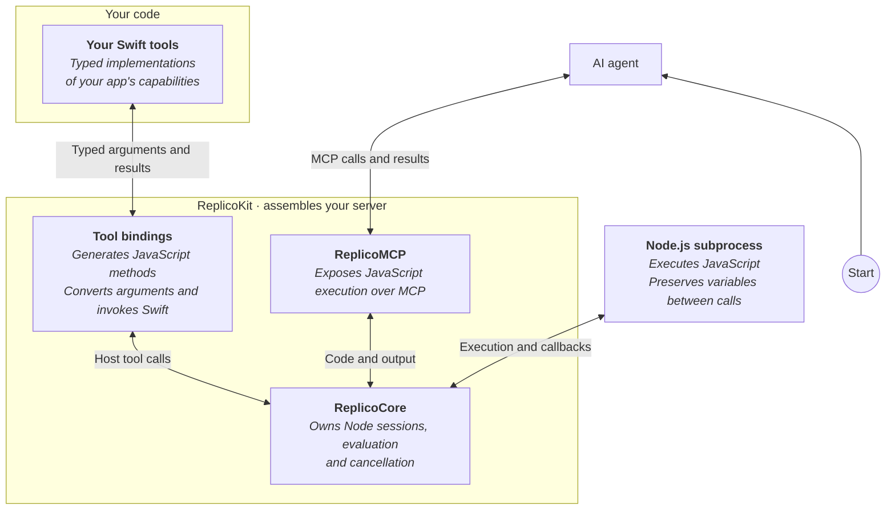

# REPLico

REPLico makes your app an MCP server with its own persistent Node.js workspace, in the style of Codex CUA.



## Installation

In Xcode, choose **File → Add Package Dependencies…** and enter `https://github.com/julianschiavo/REPLico.git`. Use **Up to Next Major Version** starting at the [latest release](https://github.com/julianschiavo/REPLico/releases/latest), then add **ReplicoKit** to your app target.

In a Swift package, add these entries to `Package.swift`.

```swift
// In the package's dependencies array
.package(url: "https://github.com/julianschiavo/REPLico.git", from: "0.2.0")

// In your app target's dependencies array
.product(name: "ReplicoKit", package: "replico")
```

## Create a server

This example defines a tool and its entry point in an executable target named `text-server`.

```swift
import ReplicoKit

struct EchoTool: Tool {
    @ToolArguments
    struct Arguments {
        @Argument(description: "Text to return.")
        let text: String
    }

    let name = "echo"
    let description = "Return the supplied text."

    func call(arguments: Arguments, context: ToolContext) async throws -> ToolResponse<String> {
        ToolResponse(value: arguments.text)
    }
}

@main
struct TextApplication: ReplicoApplication {
    var toolGroups: [ToolGroup] {
        [ToolGroup(name: "text", tools: [EchoTool()])]
    }
}
```

You can distribute the executable on its own. ReplicoKit embeds Node and the JavaScript worker and unpacks them into the user's cache when the app first serves MCP.

## Connect it to Codex

Build your executable and register it as an MCP server.

```sh
swift build -c release --product text-server
codex mcp add text -- "$(swift build -c release --show-bin-path)/text-server"
```

Start Codex and ask it to use the text server to echo Hello. Its call to your server’s `js` tool can run the following code.

```javascript
nodeRepl.write(await text.echo({text: "Hello"}))
// Hello
```

JavaScript variables persist between calls. `js_reset` starts a fresh session and restores your registered tools.

## Examples

See [Math](Examples/Math) for a small server and [MathComplex](Examples/MathComplex) for an existing app that chooses when to serve MCP.

Requires Swift 6.4 or later. The bundled runtime supports macOS 26 or later on Apple silicon and Linux on arm64 and x64. See [architecture](Documentation/Architecture.md) for embedding and external Node configuration, [compatibility](Documentation/Compatibility.md) for JavaScript behavior, and [releasing](Documentation/Releasing.md) for package maintenance.

REPLico is available under the [MIT license](LICENSE).
