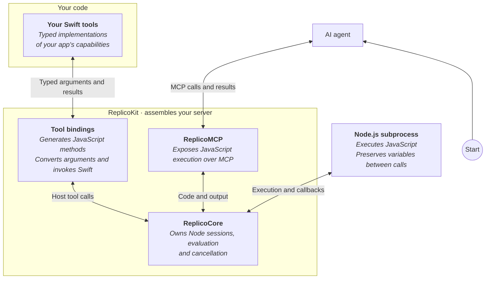

# REPLico

REPLico makes your app an MCP server with its own persistent Node.js workspace, in the style of Codex CUA.



## Create a server

Add the `ReplicoKit` product to a Swift executable target named `text-server`, then define its tools and entry point.

```swift
import ReplicoKit

struct EchoTool: Tool {
    @ToolArguments
    struct Arguments {
        @Argument(description: "Text to return.")
        let text: String
    }

    let name = "echo"
    let description = "Return the supplied text."

    func call(arguments: Arguments, context: ToolContext) async throws -> ToolResponse<String> {
        ToolResponse(value: arguments.text)
    }
}

@main
struct TextApplication: ReplicoApplication {
    var toolGroups: [ToolGroup] {
        [ToolGroup(name: "text", tools: [EchoTool()])]
    }
}
```

Node is included. Tool bindings and API documentation are generated automatically.

## Connect it to Codex

Build your executable and register it as an MCP server.

```sh
swift build -c release --product text-server
codex mcp add text -- "$(swift build -c release --show-bin-path)/text-server"
```

Start Codex and ask it to use the text server to echo Hello. Its call to your server’s `js` tool can run the following code.

```javascript
nodeRepl.write(await text.echo({text: "Hello"}))
// Hello
```

JavaScript variables persist between calls. `js_reset` starts a fresh session and restores your registered tools.

## Examples

See [Math](Examples/Math) for a small server and [MathComplex](Examples/MathComplex) for an existing app that chooses when to serve MCP.

Requires Swift 6.4 and macOS 26 or later. See [architecture](Documentation/Architecture.md) for embedding and external Node configuration, [compatibility](Documentation/Compatibility.md) for JavaScript behavior, and [releasing](Documentation/Releasing.md) for package maintenance.

REPLico is available under the [MIT license](LICENSE).
